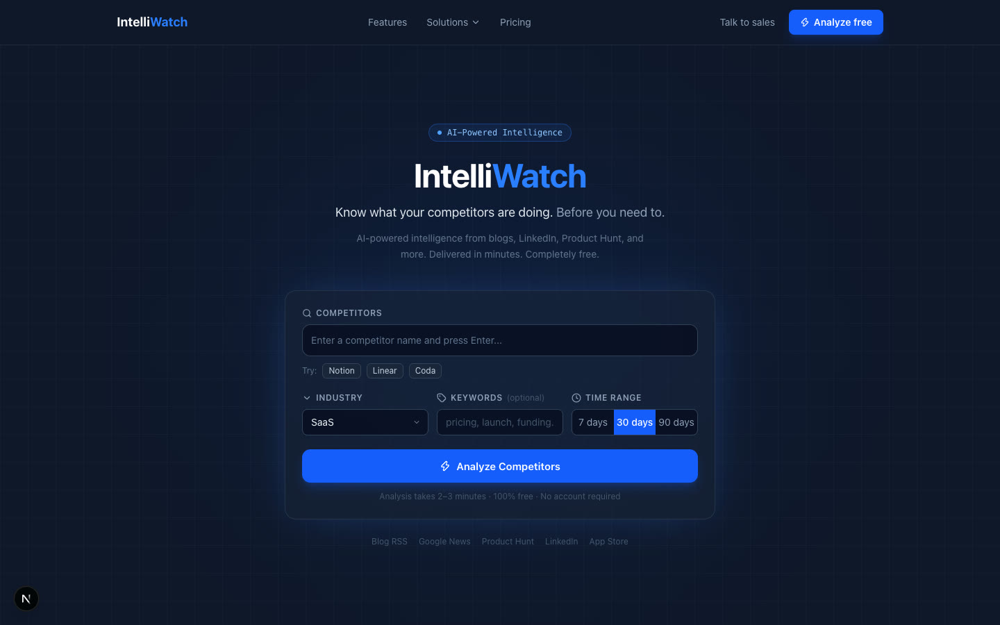
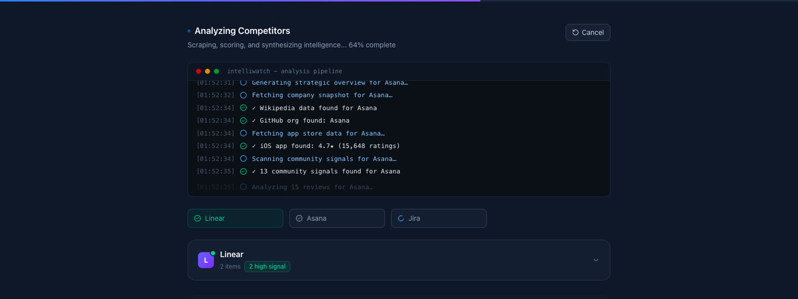
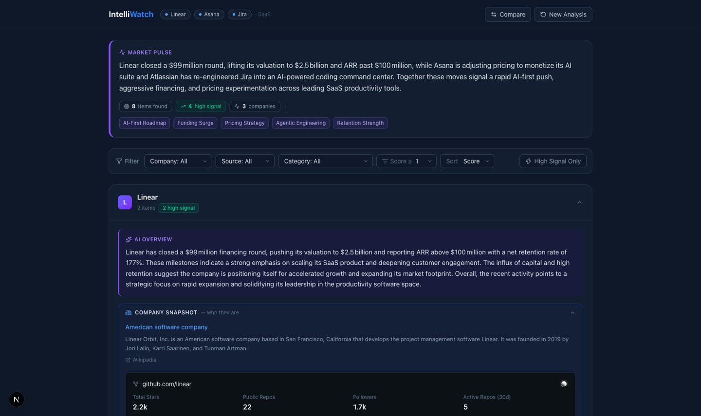
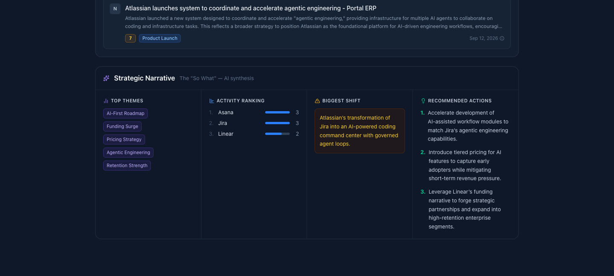
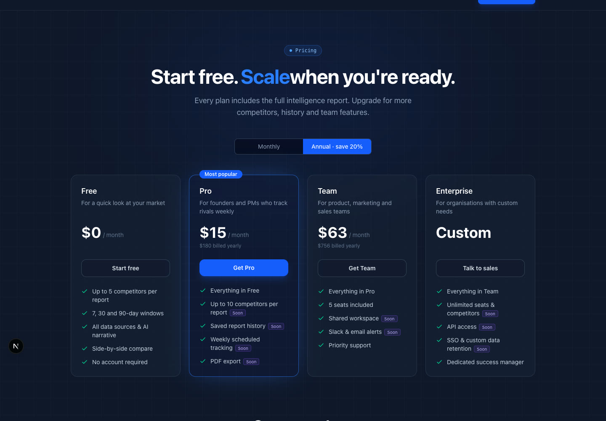

# IntelliWatch

**Know what your competitors are doing. Before you need to.**

IntelliWatch is an AI-powered competitor intelligence tool. Type in a few competitors, click **Analyze**, and watch a live pipeline scrape public sources, score every signal with AI, and build a full strategic report in one to three minutes. No account needed.




## Features

- **Live analysis pipeline**: a terminal-style log streams every step as it runs, and each competitor's card appears the moment it finishes.
- **Intelligence feed**: recent news from Google News, scored 1–10 for strategic relevance and tagged (Product Launch, Pricing, Funding, Hiring, Partnership…). Items scoring 8+ are marked **High Signal**.
- **AI overview**: a short strategic summary of what each competitor has been doing.
- **Company snapshot**: Wikipedia background plus GitHub stats (stars, followers, active repos, top projects).
- **Customer snapshot & reviews**: App Store rating, release notes and recent iOS reviews, tinted by star rating.
- **Market sentiment**: Hacker News stories, Reddit threads and press coverage.
- **Strategic narrative**: market pulse, top themes, activity ranking, the biggest competitive shift and three recommended actions.
- **Filters & compare**: filter the feed by company, category or score, and compare competitors side by side.
- **Marketing site**: Features, Solutions and Pricing pages.

| Live pipeline | Finished report |
| --- | --- |
|  |  |

| Strategic narrative | Pricing |
| --- | --- |
|  |  |

## How it works

For each competitor, `POST /api/analyze` runs this pipeline and streams progress back as newline-delimited JSON:

1. **Fetch** up to 10 recent news items (Google News RSS, filtered to the chosen 7/30/90-day window and keywords).
2. **Score** each item for relevance and category with an LLM. Items scoring 6+ pass the threshold.
3. **Summarize** the top 3 items and write a strategic overview.
4. **Enrich** with Wikipedia, GitHub, the App Store (rating and reviews), Hacker News and Reddit.
5. **Synthesize** a market pulse and strategic narrative across all competitors.

All AI calls go to [Groq](https://groq.com) (`openai/gpt-oss-120b`). Every other source is free and public.

## Tech stack

- [Next.js 16](https://nextjs.org) (App Router, Turbopack) and React 19
- TypeScript
- Tailwind CSS 4
- [lucide-react](https://lucide.dev) icons
- Groq API for LLM scoring and synthesis

## Getting started

### Prerequisites

- Node.js 20.9 or newer
- A free Groq API key from [console.groq.com](https://console.groq.com)

### Setup

```bash
git clone https://github.com/hdang2000/IntelliWatch.git
cd IntelliWatch
npm install
cp .env.local.example .env.local   # then add your GROQ_API_KEY
npm run dev
```

Open [http://localhost:3000](http://localhost:3000).

### Environment variables

| Variable | Required | Purpose |
| --- | --- | --- |
| `GROQ_API_KEY` | Yes | Powers relevance scoring, summaries and the strategic narrative. |
| `GITHUB_TOKEN` | No | Raises the GitHub API limit from 60 to 5,000 requests per hour. |
| `REDDIT_CLIENT_ID` / `REDDIT_CLIENT_SECRET` | No | Adds upvote and comment counts to Reddit posts. Without them, posts come from Reddit RSS with no scores. |

## Scripts

| Command | Description |
| --- | --- |
| `npm run dev` | Start the dev server |
| `npm run build` | Production build |
| `npm run start` | Serve the production build |
| `npm run lint` | Run ESLint |
| `npm run typecheck` | Run the TypeScript compiler without emitting |

## Project structure

```
src/
├── app/
│   ├── api/analyze/route.ts   # Streaming analysis endpoint (NDJSON)
│   ├── page.tsx               # Home: search form → live pipeline → report
│   ├── features/  solutions/  pricing/
│   └── layout.tsx, globals.css, icon.svg
├── components/
│   ├── SearchForm.tsx, PipelineTerminal.tsx, CompanyCard.tsx, ReportSections.tsx
│   └── site/                  # Navbar, footer, marketing sections and content
└── lib/
    ├── pipeline.ts            # Orchestrates each analysis step
    ├── groq.ts                # Groq client with JSON mode and retries
    └── sources/               # news, wikipedia, github, appstore, community
```

## Known limitations

- Companies with common-word names (for example "Linear") can pick up unrelated news, Hacker News and Reddit results.
- Reddit blocks anonymous JSON search, so vote counts need the optional Reddit credentials, and it may rate-limit heavy use.
- AI summaries can be wrong. Check the source links before acting on them.
- Pricing tiers and features marked "Soon" on the marketing pages are placeholders.

## License

[MIT](LICENSE)
